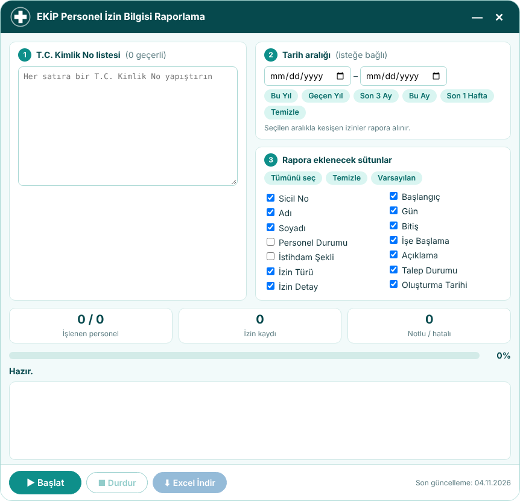

# EKİP Personel İzin Bilgisi Raporlama

EKİP (Entegre Kurumsal İşlem Platformu) sisteminde **Sağlık Sistemi > Sicil > Sicil İşlemleri > Ücretli İzin İşlemleri** sayfasında çalışan, T.C. Kimlik No listesiyle toplu izin bilgisi raporlayan yer imi (bookmarklet) aracıdır.

## Özellikler
- T.C. Kimlik No listesiyle toplu sorgu; çok sayfalı izin kayıtlarının tamamı okunur
- Tarih aralığı filtresi ve sütun seçimi
- Tek Excel (.xlsx) dosyası, iki sayfa:
  - **İzin ve Rapor Bilgileri**: personel bilgileri ve izin kayıtları (başlangıç tarihine göre yeniden eskiye)
  - **Yıllık İzin Bilgileri**: personel başına devreden, hak edilen, kullanılan ve kalan izin
- Yalnızca okur; veri dışarı gönderilmez; harici kütüphane kullanmaz

## Kurulum
1. GitHub Pages ile yayınlanan `index.html` sayfasını açın.
2. Sayfadaki yer imi düğmesini yer imleri çubuğuna sürükleyin.
3. EKİP'te ilgili izin sayfası açıkken yer imine tıklayın.

## Dosyalar
| Dosya | Açıklama |
|---|---|
| `index.html` | Kurulum sayfası (yer imi ve yedek kod içerir) |
| `izin-raporu.js` | Okunabilir kaynak kod |
| `izin-raporu.min.js` | Yer imine gömülen küçültülmüş kod |
| `onizleme.png` | İşlem penceresi ekran görüntüsü |

## Yayınlama
Depo ayarlarında **Settings > Pages > Branch: main / (root)** seçilerek yayınlanır.

## Gizlilik
Girilen T.C. Kimlik No'lar ve raporlanan veriler yalnızca tarayıcıda işlenir; hiçbir sunucuya gönderilmez. Depoda kişisel veri bulunmaz.
